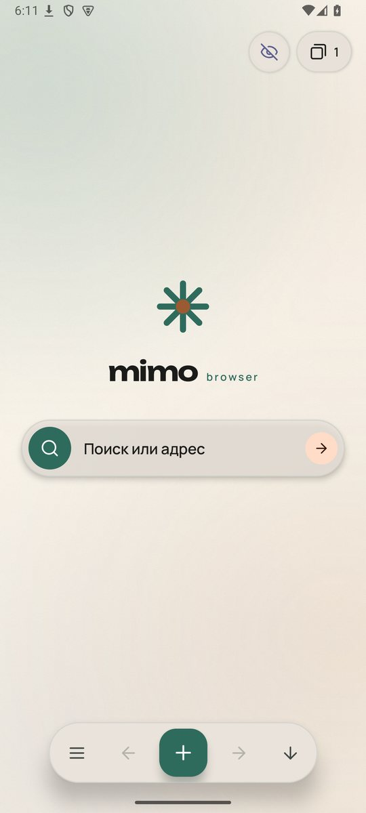
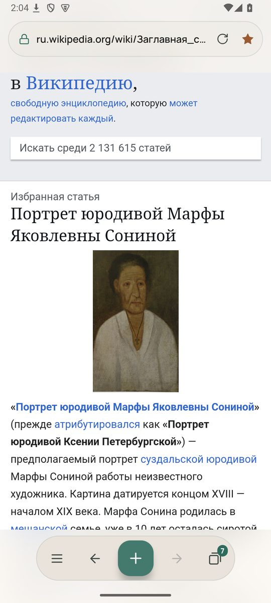
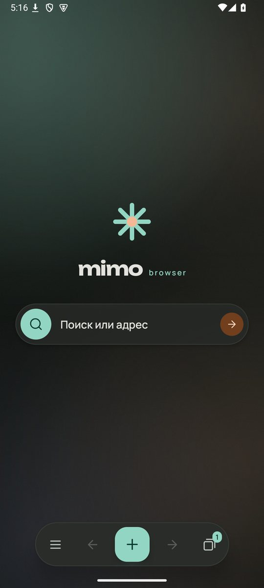
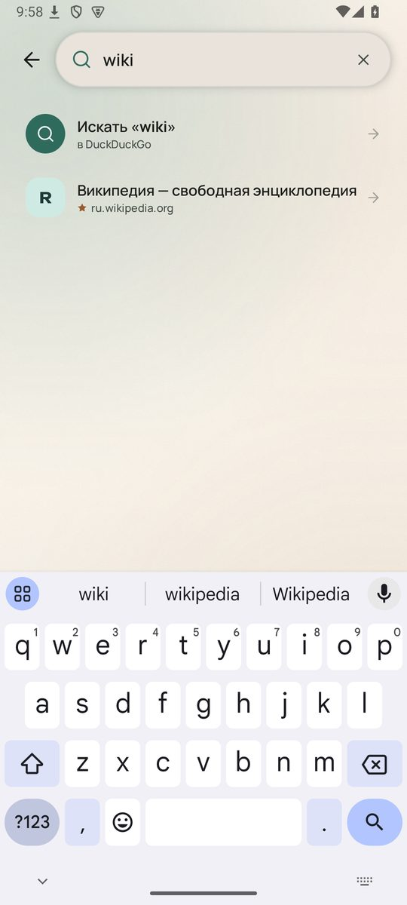
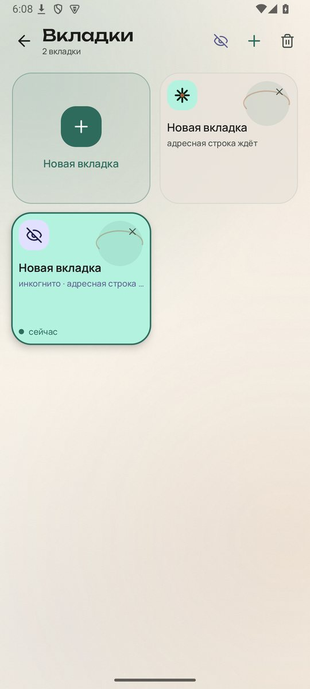
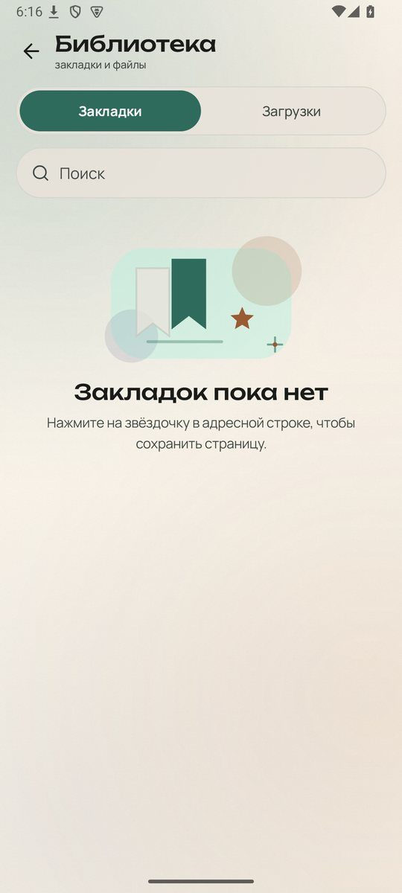
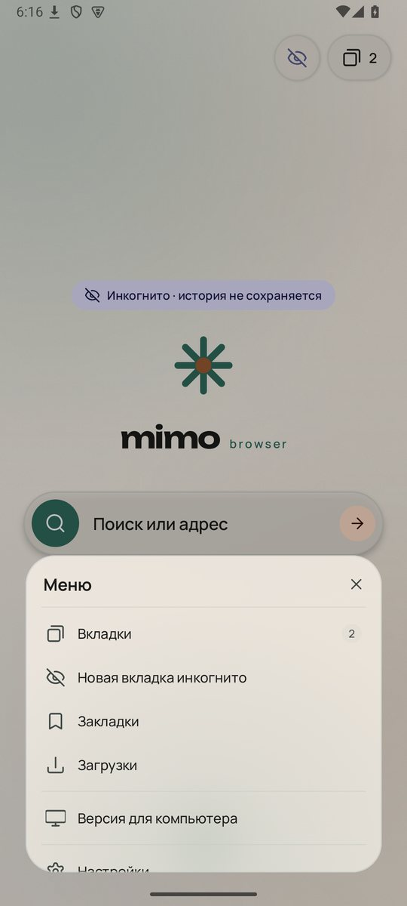
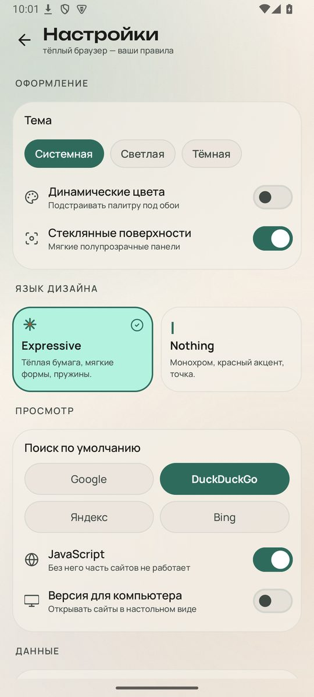
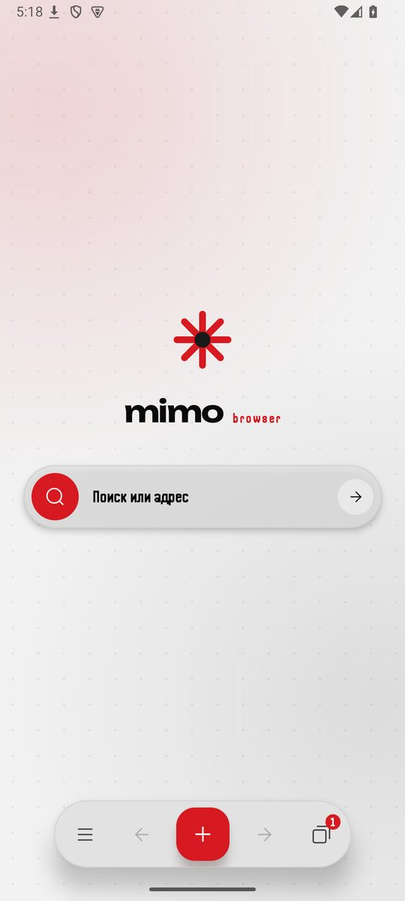

# Mimo Browser

**Mimo Browser** — тёплый браузер для Android на **Material 3 Expressive**.
Вкладки, закладки, история и загрузки в спокойном интерфейсе с бумажной
палитрой, пружинными анимациями и крупной типографикой. Без аккаунта, без
облака и без лишнего шума.

[Сайт](https://dokmoshen.github.io/mimo/browser.html) ·
[Скачать APK](https://github.com/dokmoshen/mimo-browser/releases/latest/download/mimo-browser.apk) ·
[GitHub Releases](https://github.com/dokmoshen/mimo-browser/releases) ·
GPL-3.0 · Android 9+

  
  
  

## Возможности

### Вкладки

- Несколько вкладок с переключением, закрытием и закрытием всех сразу.
- Открытые вкладки и активная вкладка сохраняются между запусками.
- Карточки вкладок с названием, сайтом и значком.
- Новая вкладка открывается одним нажатием из нижнего дока.

### Поиск и адрес

- Одна строка для адреса и поискового запроса.
- Адресная строка-пилюля плавно скрывается при прокрутке и возвращается
  движением вверх.
- Подсказки из закладок и истории, быстрый поиск в интернете.
- Выбор поисковика: Google, DuckDuckGo, Яндекс или Bing.
- Прогресс загрузки и кнопка остановки прямо в строке.

### Дом

- Большой поиск и быстрый доступ к любимым сайтам.
- Недавняя история с аккуратными карточками.
- Плавающий док: меню, назад, новая вкладка, вперёд, вкладки.
- Меню раскрывается из дока одной живой поверхностью.
- Пустые состояния с рисованными сценами.

### Закладки, история и файлы

- Закладки звёздочкой и отдельная библиотека закладок.
- История посещений с группировкой по дням и поиском.
- Загрузки с размером, статусом, открытием и отправкой файла.
- Удаление отдельных записей и очистка разделов.
- Поиск по библиотеке.

### Браузер

- Файловый выбор для форм загрузки на сайтах.
- Диалоги JavaScript в оформлении Mimo.
- Полноэкранное видео.
- Внешние ссылки `mailto:`, `tel:` и `intent://` открываются системой.
- Настольная версия сайтов и отключение JavaScript.
- Предупреждение о незащищённом HTTP-соединении.
- Очистка cookies, кэша и данных сайтов.
- Открытие ссылок из других приложений и отправка текущей страницы.

### Оформление

- Светлая, тёмная и системная темы.
- Динамические цвета Android 12+.
- Два характера: **Expressive** с тёплой бумагой и **Nothing** с монохромом,
  красным акцентом и точечным шрифтом.
- Крупная типографика Unbounded + Manrope.
- Мягкие градиенты, бумажное зерно и пружинные анимации.
- Стеклянная панель меню с размытием страницы под ней.
- Стеклянные адресная строка и док на сайтах: фон с размытием, а не глухая плашка.

## Скриншоты

| Главный экран | Поиск | Вкладки |
|---|---|---|
|  |  |  |

| Страница | Библиотека | Меню |
|---|---|---|
|  |  |  |

| Тёмная тема | Настройки | Nothing |
|---|---|---|
|  |  |  |

## Установка

1. Скачайте APK на устройство Android 9 или новее.
2. Разрешите установку из этого источника.
3. Откройте Mimo Browser и начните со строки поиска.

## Приватность

История, закладки, настройки и загруженные файлы остаются на устройстве.
Нет аккаунта, синхронизации и телеметрии. Сайты получают сетевой доступ
только когда вы сами открываете страницу.

## Лицензия

GPL-3.0. Тексты лицензий шрифтов и Lucide лежат в
`app/src/main/assets/licenses/`.
